  

  

## 🦋 About me

- 🧩 **Full stack first.** React and Next.js on the front, Node.js, Express and FastAPI on the back, with PostgreSQL, MongoDB or MySQL underneath.
- ☁️ **Then cloud.** AWS (Lambda, S3), Docker and GitHub Actions, including a tool that explains why an AWS bill changed.
- 📊 **Data and 🤖 AI/ML, side by side.** Explainable models (LightGBM with SHAP), and LLMs kept on a short leash so they can't make things up.
- ♿ **Accessibility and delight.** Software should work for everyone, and it's allowed to be a little fun.
- 🎓 MCA student at CHRIST University.

## 🛠️ Tech stack

<b>Languages</b>  
  

<b>🧩 Full stack</b>  
  

<b>☁️ Cloud and DevOps</b>  
  

<b>📊 Data and 🤖 AI/ML</b>  
   
  plus pandas · LightGBM · SHAP · Ollama (local LLMs)

## 🚀 Featured projects

### 🧩 Full stack

| Project | What it does | Built with |
| --- | --- | --- |
| 🌳 [**Policy Tree Editor**](https://github.com/kuheli7/tree-editor) | A visual editor for compliance policy trees: drag-and-drop nodes, checks for orphans and circular references, auto-layout, undo/redo and JSON import/export | Next.js · TypeScript · React Flow · Zustand · Tailwind |
| 🧠 [**MindCare**](https://github.com/kuheli7/MindCare) · [live](https://mindcaree.netlify.app/) | A team-built mental well-being platform for students, with assessments for stress, anxiety, burnout and sleep, JWT auth and separate student and admin views | React · Node.js · Express · MongoDB · JWT |
| 🔌 [**HubSpot Deals ETL**](https://github.com/kuheli7/hubspot-deals-etl) | Pulls HubSpot CRM deals into PostgreSQL with checkpoints and rate limiting. A scan can pause, resume and recover after a crash | Flask-RESTX · dlt · PostgreSQL |

### ☁️ Cloud

| Project | What it does | Built with |
| --- | --- | --- |
| 🔍 [**CostLens**](https://github.com/kuheli7/costLens) | Explains why an AWS bill changed, down to the resource and the CloudTrail event, in plain English on Slack. It named the right cause in all 240 injected test incidents on synthetic billing data, and a validator stops the LLM from inventing numbers | Python · FastAPI · React · AWS Lambda |

### 📊 Data and 🤖 AI/ML

| Project | What it does | Built with |
| --- | --- | --- |
| 💳 [**CreditLens**](https://github.com/kuheli7/credit-risk-platform) · [live](https://creditlens-credit-risk-platform.onrender.com/?page=scoring) | Credit risk scoring with explainable underwriting (SHAP), policy rule derivation and natural-language questions about the portfolio | FastAPI · LightGBM · SHAP · Groq · Docker |
| 🎙️ [**VoiceNav**](https://github.com/kuheli7/VoiceNav) | Hands-free browsing for people who can't use a mouse or keyboard: say "click add to cart" or "open the cheapest one". It runs a local LLM, so there's no cloud and no API cost. Accuracy went from 64% to 94% on a 50-command test set (82% on held-out commands) | JavaScript · FastAPI · Ollama |

## 🦋 Meet Lumi

  

Lumi is the moth floating around this page: a marshmallow-sized baby moth who starts a new hobby every night and never finishes any. I built their homepage for the haX.baby hackathon, with a chat, a 3D attic, a mini-game and a guestbook. [Come say hi →](https://kuheli7.github.io/lumi-baby-moth/)

## ☕ Side quests

Small business sites, because every café and mithai shop deserves a good menu:

- 🍬 [**Gulab & Co.**](https://github.com/kuheli7/Gulab-and-Co): a custom dabba (box) builder with WhatsApp ordering
- 🌿 [**Sip & Sage**](https://github.com/kuheli7/sip-and-sage-cafe): a café menu with table QR codes, a cart and a dark/light theme
- 🥤 [**Brew & Bounce**](https://github.com/kuheli7/brew-and-bounce): "Big coffee. Bigger moods."

 

  

<h3 align="center"><i>I build things that are useful, then make them a little delightful. ✨</i></h3>

<i>Currently: trying to be better, one commit at a time.</i>

