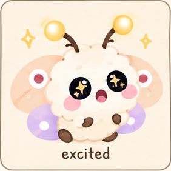
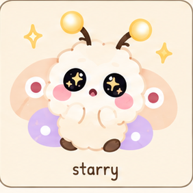
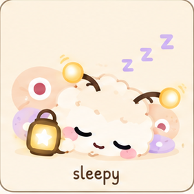
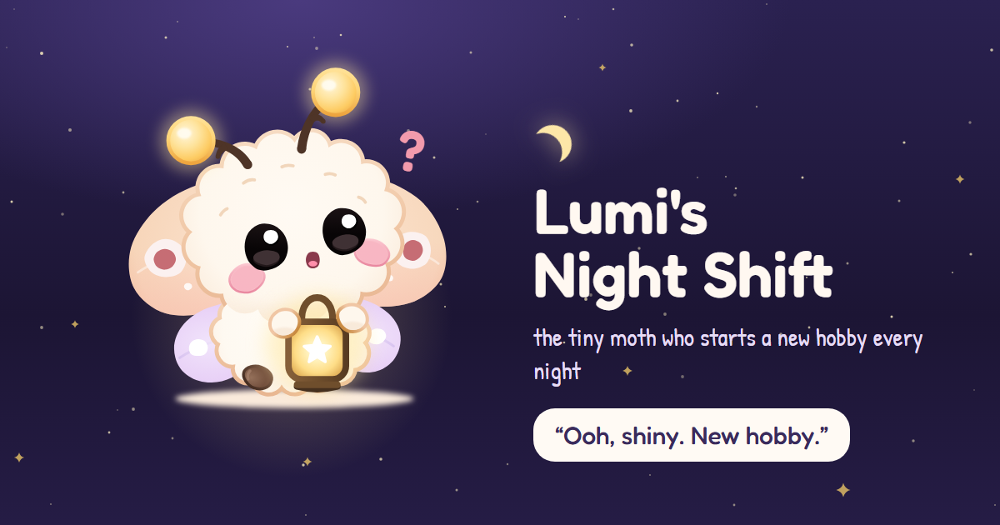

<h1 align="center">Hi, I'm Kuheli 👋</h1>

  <i>I build things that are useful, then make them a little delightful.</i>

  
  
  
  
  

That's Lumi, my baby moth. More on them below. 🦋

  
  
  
  
  
  
  
  
  
  

---

## ✨ What I'm into

- 🧠 **Data and ML that explains itself**: credit scoring with SHAP, cloud cost analysis where an LLM is never allowed to invent a number
- 🧩 **Front-end that feels good to use**: visual editors, dashboards, mobile-first sites
- 🎙️ **Accessibility**: tools that let people use the web without a mouse or keyboard
- 🦋 **Weird side projects**: sometimes a homepage for a baby moth is the right call

## 🚀 Featured projects

| Project | What it does | Built with |
| --- | --- | --- |
| 🌳 [**Policy Tree Editor**](https://github.com/kuheli7/tree-editor) · [live](https://tree-editor-gilt.vercel.app) | A visual editor for compliance policy trees: drag-and-drop nodes, validation for orphans and circular references, auto-layout, undo/redo, JSON import/export | Next.js, TypeScript, React Flow, Zustand, Tailwind |
| 🔍 [**CostLens**](https://github.com/kuheli7/costLens) | Explains why your AWS bill changed, down to the resource and the CloudTrail event. A deterministic engine computes every figure, and a validator rejects any number the LLM makes up | Python, AWS Lambda, CUR, Slack |
| 🎙️ [**VoiceNav**](https://github.com/kuheli7/VoiceNav) | Hands-free browsing in Chrome or Edge: say "click add to cart" or "open the cheapest one". Runs a local AI model, so no cloud and no API cost | JavaScript, FastAPI, Ollama |
| 💳 [**CreditLens**](https://github.com/kuheli7/credit-risk-platform) · [live](https://creditlens-credit-risk-platform.onrender.com/?page=scoring) | Credit risk platform with explainable underwriting (SHAP), policy rule derivation and natural-language portfolio analysis | FastAPI, LightGBM, Groq, Docker |
| 🔌 [**HubSpot Deals ETL**](https://github.com/kuheli7/hubspot-deals-etl) | Checkpointed, rate-limited extraction of HubSpot CRM deals into PostgreSQL that can pause, resume and recover after a crash | Flask-RESTX, dlt, PostgreSQL |
| 🦋 [**Lumi's Night Shift**](https://github.com/kuheli7/lumi-baby-moth) · [live](https://kuheli7.github.io/lumi-baby-moth/) | The homepage of a baby moth who starts a new hobby every night. Has a chat, a 3D attic, a mini-game and a guestbook. Made for the haX.baby hackathon | JavaScript, CSS |

## 🦋 Meet Lumi

  

Lumi is a marshmallow-sized baby moth who starts a new hobby every night and never finishes any. I built their homepage for the haX.baby hackathon. [Come say hi →](https://kuheli7.github.io/lumi-baby-moth/)

## ☕ Side quests

Small business sites, because every café and mithai shop deserves a good menu:

- 🍬 [**Gulab & Co.**](https://github.com/kuheli7/Gulab-and-Co): a custom dabba (box) builder with WhatsApp ordering
- 🌿 [**Sip & Sage**](https://github.com/kuheli7/sip-and-sage-cafe): a café menu with table QR codes, a cart and a dark/light theme
- 🥤 [**Brew & Bounce**](https://github.com/kuheli7/brew-and-bounce): "Big coffee. Bigger moods."

## 📫 Say hi

- GitHub: you're already here 🙂
- Email: <!-- add your email -->
- LinkedIn: <!-- add your LinkedIn -->

---

<i>Currently: trying to be better, one commit at a time.</i>

